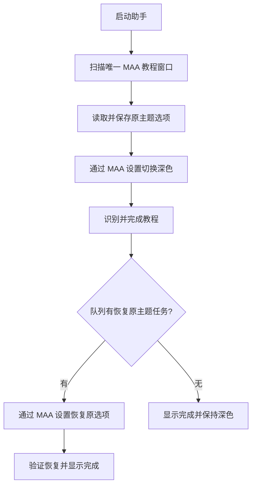

# 技术方案与前置调查

状态：S1 接入中，已验证窗口前台截图与中文 OCR；教程、主题和任务执行尚未实现。

## 程序结构

采用一个 Windows 桌面程序、一个 MaaFramework 控制会话和一个串行任务队列。优先使用官方 C# Binding，避免自制通用工作流引擎。

建议的最小源码职责：

- `MainWindow`：MAA 风格 HUD、任务行、「＋」菜单、日志和停止。
- `TutorialRunner`：自动寻找窗口、主题前置、教程流程、恢复任务、取消和超时。
- `resources/pipeline`：需要的识别节点与流程资源。
- `SessionState`：原主题恢复记录；仅在确有持久化逻辑时独立成文件。

是否拆分文件按实际复杂度决定，不预先创建插件、服务端、数据库、事件总线或多层抽象。

## 数据流

找不到窗口、多个候选、识别失败和停止请求都结束本次输入链，不将结果当作完成。

## 主题恢复记录

在执行切换之前持久保存：记录版本、目标程序身份、进程启动时间、本次会话标识、原主题枚举、是否由助手改变主题、恢复是否完成。不要保存游戏账号、凭据或整份 MAA 配置。

原主题至少区分 `Dark`、`Light`、`System`。恢复成功后将记录标记完成；异常退出时保留，后续启动核验目标身份后才允许继续。教程运行重试不重写未完成记录中的原主题。

程序不读写 MAA 的教程进度或主题配置文件来执行操作。开发测试允许在已经关闭的隔离测试副本中恢复起始快照，这属于测试准备，不属于产品功能。

## 窗口与识别

- 使用进程元数据和窗口信息筛选 MAA，结合画面确认教程身份。
- 实际截图和输入走 MaaFramework Win32 controller。
- 使用 OCR/模板识别文本、按钮、主题选项和提示；画面颜色只辅助确认深浅主题。
- 初始浅色只需覆盖打开设置、读取主题、选择深色和返回教程所需页面。
- 参数化记录实际窗口客户区与 DPI；不把本次观察到的像素坐标当成全局坐标。
- 独立弹窗和菜单只接管目标进程所属窗口，禁止误点浏览器或其他软件。

## 已核查环境

2026-11-04，Windows x64：

- 本机原有 .NET 6/7/8/10 运行时和 WindowsDesktop 运行时，原先没有 SDK；现已在项目 `dependencies/` 内安装独立 .NET SDK 8.0.427。
- 当前 MaaFramework 最新发布为 v5.15.0，Windows x64 压缩包约 80 MB。
- 官方 C# Binding 最新发布为 v5.10.0；其发布说明对应 MaaFramework v5.10.5。
- 本次选择 Binding 5.10.0 + MaaFramework Runtime 5.10.5，框架探针实际返回 `v5.10.5`。
- 已有中文 PP-OCRv4 模型与开发构建；未配置全局 PATH 或更换系统运行时。SDK 首次运行自动生成了开发证书，未执行信任；后续脚本已关闭该默认行为。

## S1 实测发现

- 当前环境的 FramePool 截图在 WinRT `CreateForWindow` 返回访问拒绝，不能作为当前实现的默认方式。
- 改用 MaaFramework `ScreenDC` 前台截图后成功获得 835×720 图像，中文 OCR 返回 20 个文本框，包括简体中文、与系统同步及 MAA 标题。
- 输入仍由 MaaFramework Win32 controller 提供；本轮未发送教程操作。
- 初始化失败的清理、超时、取消和完整 HUD 启动仍待接入收尾，当前不宣称 S1 全部完成。

## 依赖与输出归位

- 开发 SDK：优先复用可用正式工具目录；需要安装时采用独立目录，不覆盖系统运行时。
- 正式运行依赖与识别资源：项目 `dependencies/` 和源码约定的资源目录，附清单。
- 测试 MAA：项目 `test-environments/`，不含入 Git，不打入助手交付包。
- 构建中间物、下载包、日志与截图：工作区 `tmp/agent-scratch/` 本任务目录。
- 发布产物：项目 `releases/`，必须脱离中间目录验证启动。

已有临时教程预览属于上一步实验，不作为程序的硬编码依赖：
`D:\AI_work_space\tmp\agent-scratch\20261104-192556-maa-tutorial-preview`。

后续如将其中证据纳入正式验收，应保存原证据及索引，不改写旧路径事实。

## 官方依据

- [MAA 本地版本教程状态机](https://github.com/MaaAssistantArknights/MaaAssistantArknights/blob/561fca9d0ab37e07256b6514fe970847f0fcafa6/src/MaaWpfGui/ViewModels/UI/SettingsViewModel.cs)
- [MAA 教程界面](https://github.com/MaaAssistantArknights/MaaAssistantArknights/blob/561fca9d0ab37e07256b6514fe970847f0fcafa6/src/MaaWpfGui/Views/UserControl/GuideUserControl.xaml)
- [MaaFramework v5.15.0](https://github.com/MaaXYZ/MaaFramework/releases/tag/v5.15.0)
- [官方 C# Binding v5.10.0](https://github.com/MaaXYZ/MaaFramework.Binding.CSharp/releases/tag/v5.10.0)
- [Pipeline 协议](https://github.com/MaaXYZ/MaaFramework/blob/main/docs/zh_cn/3.1-任务流水线协议.md)
- [MaaFramework 许可证](https://github.com/MaaXYZ/MaaFramework/blob/main/LICENSE.md)
- [MAA 用户协议](https://github.com/MaaAssistantArknights/MaaAssistantArknights/blob/dev-v2/terms-of-service.md)
